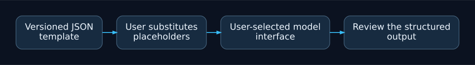

# JSON Prompt Templates

Small, versioned prompt templates for code review and clear Git commit messages.
Maintained by Mateusz Sury. The JSON files are plain text templates: they do not
call a model, transmit code or require API credentials.

## Project overview

Versioned JSON templates for evidence-based code review and clear Git commit messages.

Manual template workflow. These files do not call a model, transmit source code or require API credentials.

## Use

Read a file in `prompts/`, substitute the named placeholders in `user_template`,
and supply `system_prompt` and the substituted text to your chosen interface.
Review outputs before using them. Never substitute credentials or private code
unless the selected service and project policy permit it.

* `code-review.json`: correctness-focused review with evidence and uncertainty.
* `commit-message.json`: purpose-oriented subject and optional validation body.

Validate syntax with `python -m json.tool prompts/code-review.json`; CI checks
all prompt files and required fields. Templates are MIT licensed.
